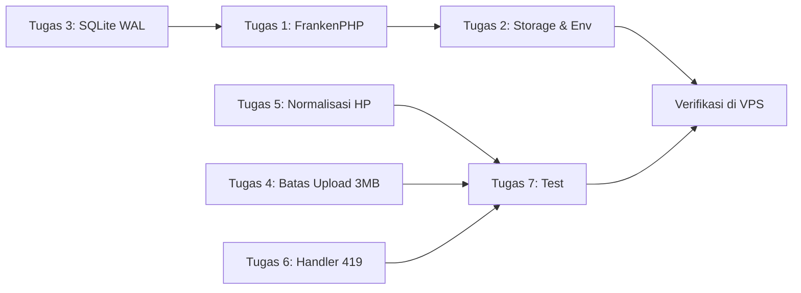

# Rencana Perbaikan: Gagal Upload & Gagal Registrasi

> Dokumen kerja untuk agent/developer yang mengeksekusi perbaikan.
> Dasar analisis: [ANALISIS_ERROR.md](file:///home/rifai/project/Store/ANALISIS_ERROR.md) (Revisi 2). Kode poin (A–F) merujuk ke sana.

## Keputusan yang Sudah Disepakati

| Topik | Keputusan | Alasan |
|---|---|---|
| Server PHP | **FrankenPHP, mode klasik** (bukan worker mode / Octane) | Multi-thread, production-ready, 1 container. Worker mode dihindari karena ada service singleton (`ShopSettingService`, dll.) yang bisa membocorkan state antar-request. |
| Database | **Tetap SQLite** + WAL + `busy_timeout` | RAM VPS hanya 2 GB dan swap sudah terpakai. MySQL (±400 MB) tidak sepadan untuk proyek tugas kuliah. |
| Upload besar | **Tolak** dengan pesan jelas, **maks 3 MB per file** | Klien low budget dan RAM server kecil. Tidak ada kompresi di sisi client. |
| Format nomor HP | **`628xxxxxxxxx`** (internasional, cocok untuk link `wa.me`) | Satu format baku di seluruh aplikasi. |
| Data production | Masih testing, **tidak ada data yang wajib dipertahankan** | Migrasi data boleh sederhana. Data duplikat boleh dibersihkan. |

## Batasan Penting

- **Jangan** tambah service baru di docker-compose (MySQL, Redis, queue worker): RAM terbatas.
- **Jangan** aktifkan FrankenPHP worker mode / Laravel Octane.
- **Jangan** ubah skema tabel selain yang disebut di dokumen ini.
- Semua pesan error untuk user wajib **berbahasa Indonesia**.

---

## Tugas 1: Ganti `artisan serve` dengan FrankenPHP (Poin A)

**File:** [Dockerfile](file:///home/rifai/project/Store/Dockerfile), [docker-entrypoint.sh](file:///home/rifai/project/Store/docker-entrypoint.sh), [docker-compose.yml](file:///home/rifai/project/Store/docker-compose.yml), [.dockerignore](file:///home/rifai/project/Store/.dockerignore)

1. Base image Dockerfile diganti dari `php:8.3-cli-alpine` ke `dunglas/frankenphp:1-php8.3-alpine`.
   - Pertahankan `install-php-extensions` untuk: `pdo_sqlite sqlite3 intl gd zip bcmath opcache pcntl`. Pastikan GD dikompilasi dengan dukungan WebP (cek `imagewebp` tersedia).
   - Pertahankan langkah composer (`--no-dev`, `dump-autoload --optimize`).
2. Tambahkan file `docker/php.ini` lalu copy ke `$PHP_INI_DIR/conf.d/zz-app.ini`:
   ```ini
   upload_max_filesize = 4M
   post_max_size = 40M
   memory_limit = 256M
   max_execution_time = 60
   max_input_time = 60
   expose_php = Off
   opcache.enable = 1
   opcache.validate_timestamps = 0
   ```
   - `upload_max_filesize` sengaja **4M** (lebih besar dari batas aplikasi 3 MB), supaya file 3–4 MB ditolak oleh **validasi Laravel** dengan pesan yang rapi, bukan dibuang diam-diam oleh PHP.
   - `post_max_size = 40M` menampung admin yang upload maks 10 foto × 3 MB + field form.
3. Jalankan server di [docker-entrypoint.sh](file:///home/rifai/project/Store/docker-entrypoint.sh#L40), ganti baris `exec php artisan serve ...` menjadi:
   ```bash
   exec frankenphp php-server --listen :8002 --root /var/www/html/public
   ```
   (mode klasik, tanpa `--worker`). Hapus `PHP_CLI_SERVER_WORKERS` dari Dockerfile dan docker-compose karena sudah tidak relevan.
4. Tambahkan `.env` ke [.dockerignore](file:///home/rifai/project/Store/.dockerignore) agar `.env` lokal (`APP_DEBUG=true`, `APP_ENV=local`) **tidak ikut ter-bake ke image**. Juga tambahkan `storage/logs/*`, `storage/framework/sessions/*`, `storage/framework/views/*`, `storage/framework/cache/*`, dan `database/*.sqlite*`.
5. Entrypoint:
   - Konfigurasi production diambil dari `env_file: .env` di docker-compose (sekarang benar-benar sampai ke aplikasi karena tidak lagi lewat `artisan serve`).
   - Hapus logika `cp .env.example .env` + `key:generate`. Ganti dengan **gagal keras** jika `APP_KEY` kosong:
     ```bash
     if [ -z "$APP_KEY" ]; then echo "ERROR: APP_KEY belum di-set di .env server"; exit 1; fi
     ```
     Alasan: key yang di-generate ulang setiap container dibuat akan membatalkan semua session/cookie (419).
   - Tambahkan `php artisan config:cache`, `route:cache`, dan `view:cache` setelah migrate.
   - Pertahankan `storage:link --force` dan `migrate --force`. Hapus `|| true` pada `migrate` agar kegagalan migrasi terlihat di log container.
   - Ganti `chmod -R 777` dengan `chown -R www-data:www-data` saja jika FrankenPHP berjalan sebagai www-data. Jika berjalan sebagai root, cukup pastikan direktori ada.
6. Perbarui pesan echo URL di entrypoint (tidak lagi hardcode `localhost`).

**Kriteria selesai:**
- `docker compose up --build` berjalan, situs bisa diakses di `:8002`.
- `docker compose exec app php -i | grep -E "upload_max_filesize|post_max_size|memory_limit"` menampilkan nilai baru.
- Dua request lambat paralel (misalnya dua upload sekaligus) **tidak saling memblokir**.

---

## Tugas 2: Persistensi Storage & Konfigurasi Production (Poin A.1, D, F)

**File:** [docker-compose.yml](file:///home/rifai/project/Store/docker-compose.yml), [.env.example](file:///home/rifai/project/Store/.env.example), [.gitignore](file:///home/rifai/project/Store/.gitignore), [config/filesystems.php](file:///home/rifai/project/Store/config/filesystems.php)

1. Ubah volume di docker-compose dari `./storage/app` menjadi **seluruh `./storage`**, supaya `storage/framework/sessions` dan `storage/logs` persisten saat container dibuat ulang:
   ```yaml
   volumes:
     - ./storage:/var/www/html/storage
     - ./database:/var/www/html/database
   ```
   Entrypoint sudah `mkdir -p` subfolder yang dibutuhkan, jadi aman untuk volume yang kosong.
2. Hapus blok `environment:` di docker-compose yang menduplikasi isi `.env`. Cukup andalkan `env_file`.
3. Perbarui [.env.example](file:///home/rifai/project/Store/.env.example) sebagai template production:
   ```ini
   APP_ENV=production
   APP_DEBUG=false
   LOG_LEVEL=warning
   DB_CONNECTION=sqlite
   DB_DATABASE=/var/www/html/database/database.sqlite
   SESSION_DRIVER=file
   CACHE_STORE=file
   QUEUE_CONNECTION=sync
   ```
   Alasan: dengan SQLite, session dan cache **jangan** memakai driver `database`, karena setiap page view akan menulis ke file DB yang sama (lock contention).
4. Keluarkan symlink dari git:
   ```bash
   git rm --cached public/storage
   ```
   lalu tambahkan `/public/storage` ke [.gitignore](file:///home/rifai/project/Store/.gitignore). Symlink tetap dibuat oleh entrypoint (`storage:link --force`).
5. **Jangan** ubah `root` disk `public` di [config/filesystems.php](file:///home/rifai/project/Store/config/filesystems.php#L43) kecuali diperlukan. Logika `PUBLIC_STORAGE_PATH` dipakai untuk opsi shared hosting.

**Kriteria selesai:**
- Login, lalu `docker compose up -d --force-recreate`, lalu refresh halaman: user **masih login** (tidak ada 419).
- `git ls-files public/storage` kosong.

---

## Tugas 3: SQLite WAL + Busy Timeout (Faktor Pendukung)

**File:** [config/database.php](file:///home/rifai/project/Store/config/database.php#L35-L45)

Ubah koneksi `sqlite`:
```php
'busy_timeout' => env('DB_BUSY_TIMEOUT', 5000),
'journal_mode' => env('DB_JOURNAL_MODE', 'wal'),
'synchronous'  => env('DB_SYNCHRONOUS', 'normal'),
'transaction_mode' => 'IMMEDIATE',
```
- `IMMEDIATE` mencegah error `SQLITE_BUSY` instan saat transaksi naik dari read ke write (contoh: `DB::transaction` di [OrderController::store](file:///home/rifai/project/Store/app/Http/Controllers/OrderController.php#L125)).
- File `-wal` / `-shm` akan muncul di `database/`. Folder ini sudah di-mount sebagai volume, jadi aman.
- Pastikan `.gitignore` mengabaikan `database/*.sqlite-wal` dan `database/*.sqlite-shm`.

**Kriteria selesai:** `php artisan tinker --execute="dump(DB::select('PRAGMA journal_mode'))"` menghasilkan `wal`.

---

## Tugas 4: Batas Upload 3 MB, Konsisten di Frontend dan Backend (Poin B, E)

### 4a. Backend
Seragamkan semua validasi gambar menjadi:
```
image|mimes:jpeg,jpg,png,webp|max:3072
```
Lokasi yang diubah:

| File | Field |
|---|---|
| [StoreOrderRequest.php:21-27](file:///home/rifai/project/Store/app/Http/Requests/StoreOrderRequest.php#L21-L27) | `payment_proof` |
| [AdminController.php:355](file:///home/rifai/project/Store/app/Http/Controllers/Admin/AdminController.php#L355) dan [:423](file:///home/rifai/project/Store/app/Http/Controllers/Admin/AdminController.php#L423) | `images.*` |
| [AdminController.php:533](file:///home/rifai/project/Store/app/Http/Controllers/Admin/AdminController.php#L533) dan [:580](file:///home/rifai/project/Store/app/Http/Controllers/Admin/AdminController.php#L580) | `image` artikel |
| [AdminController.php:699-700](file:///home/rifai/project/Store/app/Http/Controllers/Admin/AdminController.php#L699-L700) | `logo`, `qris_image` |

Tambahkan pesan kustom berbahasa Indonesia untuk rule `max`, `uploaded`, `image`, dan `mimes`. Contoh untuk bukti bayar:
- `max` / `uploaded`: *"Ukuran foto maksimal 3 MB. Silakan kirim screenshot bukti transfer atau perkecil fotonya."*
- `mimes` / `image`: *"File harus berupa gambar JPG, PNG, atau WebP."*

Rule `uploaded` penting: itu yang muncul ketika PHP menolak file (> `upload_max_filesize`).

Tambahkan juga handler `PostTooLargeException` di [bootstrap/app.php](file:///home/rifai/project/Store/bootstrap/app.php#L85-L89) (`withExceptions`): redirect `back()` dengan error *"Total ukuran file terlalu besar (maks 3 MB per foto)."*, sehingga user tidak melihat halaman 413 mentah.

### 4b. Frontend
1. Buat helper `resources/js/lib/imageUpload.ts`:
   - `MAX_IMAGE_BYTES = 3 * 1024 * 1024`
   - `ALLOWED_IMAGE_TYPES = ['image/jpeg', 'image/png', 'image/webp']`
   - `validateImageFile(file): string | null` yang mengembalikan pesan error berbahasa Indonesia atau `null`.
2. Terapkan di kelima input file. Jika tidak valid, **jangan** masukkan file ke form data, kosongkan `input.value`, lalu tampilkan pesan error di bawah input:
   - [Order/Create.tsx:487](file:///home/rifai/project/Store/resources/js/Pages/Order/Create.tsx#L487) (bukti bayar)
   - [MobileAdmin/Products/Form.tsx:304](file:///home/rifai/project/Store/resources/js/Pages/MobileAdmin/Products/Form.tsx#L304) (multi-file: tolak file yang tidak valid satu per satu, file valid tetap diterima)
   - [MobileAdmin/Articles/Form.tsx:177](file:///home/rifai/project/Store/resources/js/Pages/MobileAdmin/Articles/Form.tsx#L177)
   - [MobileAdmin/Settings.tsx:69](file:///home/rifai/project/Store/resources/js/Pages/MobileAdmin/Settings.tsx#L69) dan [:90](file:///home/rifai/project/Store/resources/js/Pages/MobileAdmin/Settings.tsx#L90)
3. Ganti `accept="image/*"` menjadi `accept="image/jpeg,image/png,image/webp"`.
4. Tampilkan teks bantuan statis di dekat setiap input: *"Maks. 3 MB (JPG/PNG/WebP)"*.

### 4c. ImageService
- [ImageService.php](file:///home/rifai/project/Store/app/Services/ImageService.php): hapus jalur Python (`convertWithPython`) dan file [image_processor.py](file:///home/rifai/project/Store/app/Services/image_processor.py), karena Python tidak ada di container. Sisakan GD.
- Di `convertWithPhpGd`, sebelum `imagecreatefrom*`, cek dimensi dengan `getimagesize()`. Jika `lebar × tinggi > 25_000_000` piksel (±25 MP), lewati konversi dan simpan file asli. Ini mencegah kehabisan memori pada gambar kecil secara ukuran file tetapi besar secara dimensi.
- Turunkan `$maxDim` dari 2400 ke **1600** untuk menghemat RAM dan disk.

**Kriteria selesai:**
- Pilih foto 5 MB di halaman checkout: pesan langsung muncul di browser, tidak ada request ke server.
- Bypass frontend (curl dengan file 3.5 MB): respons validasi 422/redirect dengan pesan Indonesia, bukan 500/413.
- Upload foto 2 MB: berhasil, tersimpan sebagai `.webp`.

---

## Tugas 5: Normalisasi Nomor HP ke `628xxx` (Poin C)

### 5a. Helper
Buat `app/Support/PhoneNumber.php`:
```php
final class PhoneNumber
{
    /** Kembalikan format 628xxxxxxxxx, atau null jika input kosong. */
    public static function normalize(?string $raw): ?string
    {
        $digits = preg_replace('/\D+/', '', (string) $raw);
        if ($digits === '') return null;
        if (str_starts_with($digits, '0'))  $digits = '62' . substr($digits, 1);
        elseif (str_starts_with($digits, '8')) $digits = '62' . $digits;
        return $digits;
    }

    /** Regex validasi setelah dinormalisasi: 628 + 7–11 digit. */
    public const REGEX = '/^628\d{7,11}$/';
}
```

### 5b. Terapkan normalisasi **sebelum validasi** di semua titik input

| Lokasi | Cara |
|---|---|
| [RegisteredUserController::store](file:///home/rifai/project/Store/app/Http/Controllers/Auth/RegisteredUserController.php#L22-L67) | `$request->merge(['phone' => PhoneNumber::normalize($request->input('phone'))])` sebelum `validate()`. Tambahkan rule `regex:`. `unique:users,phone` sekarang membandingkan bentuk baku. Email dummy dibuat dari nomor yang sudah dinormalisasi. |
| [LoginRequest::authenticate](file:///home/rifai/project/Store/app/Http/Requests/Auth/LoginRequest.php#L69-L81) | Untuk input non-email: `where('phone', PhoneNumber::normalize($loginInput))`. Hapus `orWhere` dan fallback `$credentials['phone']`. |
| [UpdateProfileRequest](file:///home/rifai/project/Store/app/Http/Requests/Profile/UpdateProfileRequest.php#L29) | Override `prepareForValidation()` lalu merge nomor yang sudah dinormalisasi, plus rule `regex` dan `unique` (ignore user saat ini). |
| [StoreOrderRequest](file:///home/rifai/project/Store/app/Http/Requests/StoreOrderRequest.php#L19) | `prepareForValidation()` untuk `customer_phone`, plus rule `regex`. |
| [AdminController::settingsUpdate](file:///home/rifai/project/Store/app/Http/Controllers/Admin/AdminController.php#L696-L708) | Normalisasi `shop_phone` sebelum validasi. |
| Pencarian order ([OrderController::track](file:///home/rifai/project/Store/app/Http/Controllers/OrderController.php#L219-L223), [AdminController:163](file:///home/rifai/project/Store/app/Http/Controllers/Admin/AdminController.php#L163)) | Jika input pencarian berupa angka, cari juga dengan nilai `PhoneNumber::normalize($search)`. |

Pesan validasi:
- `regex`: *"Format nomor HP tidak valid. Contoh: 081234567890."*
- `unique`: *"Nomor HP ini sudah terdaftar. Silakan masuk / login."* (sudah ada)

### 5c. Pengaman tambahan di registrasi
Bungkus `User::create()` dengan `try/catch (UniqueConstraintViolationException)`, lalu lempar `ValidationException` dengan pesan *"Nomor HP atau email sudah terdaftar."*. Ini mencegah 500 jika masih ada race condition atau celah lain.

### 5d. Migrasi data lama
Buat migration baru `database/migrations/2026_11_05_000001_normalize_phone_numbers.php`:
- Loop `users` yang `phone` tidak null, lalu normalisasi.
  - Jika hasil normalisasi **bentrok** dengan user lain: set `phone = null` pada user yang lebih baru dan tulis `Log::warning` (data masih testing, aman).
  - Perbarui juga `email` dummy `…@customer.local` agar konsisten dengan nomor baru, **jika** tidak bentrok.
- Loop `orders.customer_phone`, lalu normalisasi (tanpa constraint unique).
- `shop_settings.whatsapp_number`: normalisasi.
- `down()`: no-op (normalisasi tidak bisa dibalik).

### 5e. Frontend
- Placeholder input HP tetap `081234567890` (user boleh mengetik format lokal, server yang menormalisasi).
- Jika ada tampilan nomor HP ke user, boleh tampilkan apa adanya (`628…`).
- Cek semua link WhatsApp (`wa.me/`) yang memakai `whatsapp_number` atau `customer_phone`: pastikan tidak lagi melakukan konversi `0` ke `62` ganda di frontend. Grep: `wa.me`, `whatsapp`.

**Kriteria selesai:**
- Daftar `081234567890`, lalu daftar lagi `0812-3456-7890` / `+62 812 3456 7890` / `81234567890`: semuanya ditolak dengan pesan "sudah terdaftar" (bukan 500).
- Daftar dengan `0812 3456 7890`, lalu login dengan `+6281234567890`: **berhasil**.

---

## Tugas 6: Tangani 419 Page Expired di Frontend (Poin D)

**File:** [resources/js/app.tsx](file:///home/rifai/project/Store/resources/js/app.tsx)

Inertia v2 (`@inertiajs/react ^2.0.0`). Daftarkan listener global:
```ts
import { router } from '@inertiajs/react';

router.on('invalid', (event) => {
    if (event.detail.response.status === 419) {
        event.preventDefault();
        alert('Sesi Anda telah berakhir. Halaman akan dimuat ulang, silakan coba lagi.');
        window.location.reload();
    }
});
```
(Boleh pakai toast/komponen notifikasi yang sudah ada di proyek, alih-alih `alert`.)

**Kriteria selesai:** buka modal registrasi, hapus cookie session di DevTools, lalu submit. Muncul pesan dan halaman reload, bukan halaman error mentah.

---

## Tugas 7: Test

**Folder:** [tests/Feature](file:///home/rifai/project/Store/tests/Feature)

Tambahkan atau perbarui test:
1. `Auth/RegistrationTest`:
   - Registrasi dengan nomor HP saja berhasil, `phone` tersimpan `628…`.
   - Registrasi ulang dengan variasi format nomor yang sama ditolak dengan error validasi `phone` (bukan exception).
2. `Auth/AuthenticationTest`: login dengan format nomor berbeda dari saat daftar berhasil.
3. `OrderTest`:
   - Bukti bayar > 3 MB (`UploadedFile::fake()->image('a.jpg')->size(3500)`) ditolak dengan error `payment_proof`.
   - `customer_phone` tersimpan dalam format `628…`.
   - Sesuaikan fixture `phone => '081234567890'` di `setUp()` jika ada assertion yang bergantung pada format.
4. `AdminTest`: upload gambar produk > 3 MB ditolak.

**Kriteria selesai:** `php artisan test` hijau semua.

---

## Urutan Pengerjaan yang Disarankan



Tugas 3–7 adalah perubahan kode aplikasi dan bisa diuji lokal. Tugas 1–2 adalah perubahan infrastruktur yang perlu diuji dengan `docker compose up --build` sebelum deploy.

## Checklist Deploy ke VPS

- [ ] File `.env` di server diisi berdasarkan `.env.example` baru (`APP_ENV=production`, `APP_DEBUG=false`, `APP_KEY` terisi, `APP_URL` sesuai domain/IP).
- [ ] Backup `database/database.sqlite` sebelum deploy.
- [ ] `docker compose up -d --build`
- [ ] `docker compose logs -f app`: tidak ada error migrasi dan `APP_KEY` terbaca.
- [ ] Uji manual: registrasi (berbagai format HP), login, upload bukti bayar 2 MB (berhasil) dan 5 MB (ditolak dengan pesan), upload foto produk admin.
- [ ] Log aplikasi sekarang persisten di `./storage/logs/laravel.log` di host VPS. Gunakan file ini untuk debugging berikutnya.
